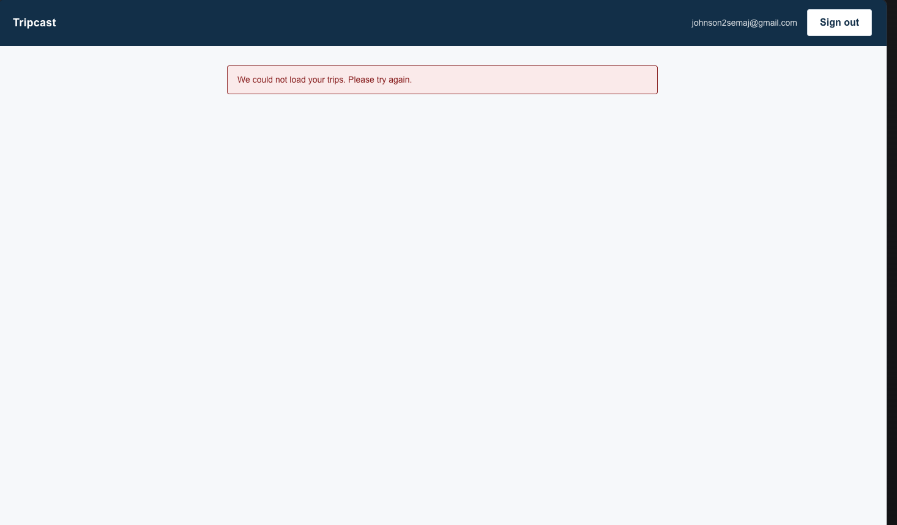
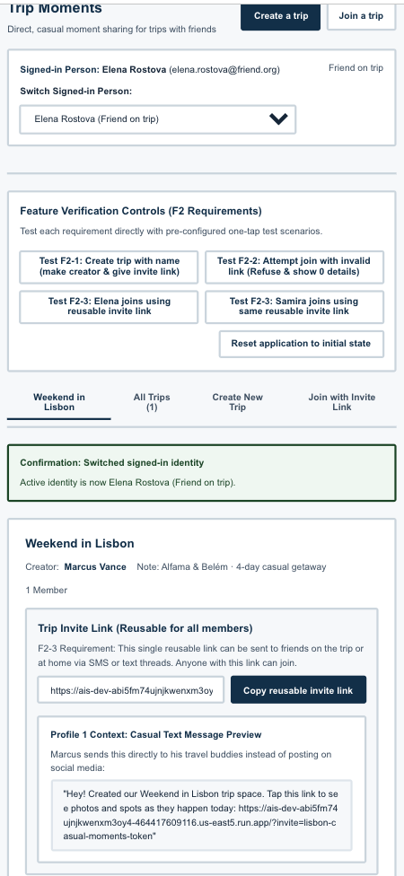

# Two Builders, One Specification

One feature from my team's specification, given to bolt.new and to Google AI Studio with the identical prompt, measured against the same EARS rows, and turned into a recommendation my team can use in Phase 2.


## Feature

**F2, Create a trip and invite members (Must-be).** Copied unchanged from my team's `context/FEATURES.md`:

> F2-1. WHEN a signed-in person creates a trip with a name, the app shall make them its creator and give them an invite link.
>
> F2-2. IF someone tries to join a trip without a valid invite link, THEN the app shall refuse and show no trip details.
>
> F2-3. The app shall give each trip one reusable invite link.

**Provenance.** Team repository: [mehtaaashi05/mgt3745-team-Alpha-](https://github.com/mehtaaashi05/mgt3745-team-Alpha-), at commit `5731bf0d1855f2e91fd7387c55fdc8e5633af116`. That commit is what both builders received.

Teammates also chose F2. Only two of my team's eight features have three or more EARS rows, which is what the assignment asks for, so four of us could not each take a different one. That constraint is itself a finding and is raised in the pull request linked below.

## See It Work

Same EARS row, opposite outcomes.

| bolt.new (Tripcast) | Google AI Studio (Trip Moments) |
|---|---|
|  |  |
| **F2-1 fails.** `create_trip()` is written correctly but cannot be reached: four 500s against the Supabase host, consistent with an access policy that queries itself. | **F2-2 fails.** A non-member sees everything the row exists to hide. The invite link is also built from the trip name, so the link leaks the trip on its own. |

More evidence in `docs/`: the sign-in screen bolt built without being asked, its browser console, and the AI Studio trip-creation screen.

## How to Run

There is no application in this repository. It holds two builds, the evidence, and the comparison.

**The code eval**, which runs one assertion against both builders' invite-code generators:

```
node --test "evals/*.test.mjs"
```

Four tests, three pass. The failure is the point: bolt's generator returns 32 random hex characters and passes; AI Studio's returns `weekend-in-lisbon-k9x2qd` and fails, because the trip name is in the link. Same test, same EARS row, opposite results.

**The builds themselves** are in `builds/bolt.zip` and `builds/aistudio.zip`, committed as downloaded. Each is a Vite project; `npm install && npm run dev` inside either will start it, though bolt's requires Supabase credentials that are not in this repository.

No deployed Worker for this assignment. F2 has no AI behavior, so the Gemini proxy step does not apply.

## Status

| | Result |
|---|---|
| EARS rows satisfied | bolt.new 1 of 3 · AI Studio 2 of 3 |
| Code eval | 4 tests, 3 pass, 1 intended failure |
| Judgment eval | 24 of 24 agreement, 100%, with a failed evidence audit |
| Prediction stake | Tight wrong, Loose half right, Open resolved |
| Spec gaps found | 6, three of them proposed to the team |
| Recommendation | Google AI Studio, 66 to 37 on a weighted comparison |

**The first finding.** Both builders invented a sign-in mechanism the specification never defines. F2-1 says "a signed-in person" and F2 never states its dependency on F1, so each filled the silence alone. bolt built real authentication on Supabase, a vendor absent from our TOOLS.md and contrary to ADR-001, and returned a `.env` holding that project's live credentials. AI Studio faked it with a dropdown over `localStorage`, which makes F2-3's reusable link impossible to test across devices. One silent sentence produced an undocumented vendor crossing in one build and an untestable Must-be row in the other.

## Links

- [`COMPARISON.md`](COMPARISON.md): row by row, scope creep, style, spec gaps, the weighted recommendation
- [`EVALS.md`](EVALS.md): the prediction stake committed before either build, its resolutions, and the error log
- [`prompts/PROMPT.md`](prompts/PROMPT.md): the exact input both builders received
- [`evals/invite-code.test.mjs`](evals/invite-code.test.mjs) and [`evals/invite-code.mjs`](evals/invite-code.mjs): the shared code eval and the two transcribed generators
- [`docs/JUDGMENT.md`](docs/JUDGMENT.md): 24 binary questions, two graders, and the audit of the second grader's evidence
- [`docs/DDR-001.md`](docs/DDR-001.md): bolt.new
- [`docs/DDR-002.md`](docs/DDR-002.md): Google AI Studio
- [`docs/DDR-003.md`](docs/DDR-003.md): Gemini as second grader
- [`docs/DDR-004.md`](docs/DDR-004.md): Claude as analyst and drafter
- [`builds/`](builds/): both projects as downloaded, unmodified
- [`context/`](context/): my team's specification at the provenance commit, unchanged

**Handoff to my team:** [pull request #68](https://github.com/mehtaaashi05/mgt3745-team-Alpha-/pull/68), proposing three changes to F2 from the spec gaps.

**Previous assignment:** [mgt3745-hw5](https://github.com/semajjohnson/mgt3745-hw5).

## AI Use

Four delegations, one record each.

| Tool | Model | What it did | Record |
|---|---|---|---|
| bolt.new | standard model, version not reported by the interface | Built F2 from the prompt, 8 minutes | [DDR-001](docs/DDR-001.md) |
| Google AI Studio | Gemini 3.8 | Built F2 from the same prompt, 5m 7s | [DDR-002](docs/DDR-002.md) |
| Gemini | 3.8 | Second grader for the judgment eval | [DDR-003](docs/DDR-003.md) |
| Claude | — | Analysis, the code eval, and most of the prose here | [DDR-004](docs/DDR-004.md) |

Two things those records say that are worth reading rather than skipping. DDR-003 notes that Gemini 3.8 graded a build Gemini 3.8 produced, which is a weakness I did not catch before running it. DDR-004 notes that three claims Claude drafted were carried over from my HW5 builds and were false for these, and that I caught them by going back to the zips rather than by reading the draft.

**Hours:** about 7. Roughly 1 on setup and the prediction stake the night before, and about 6 on evaluating both builds and writing this up. The builds themselves took 13 minutes between them.